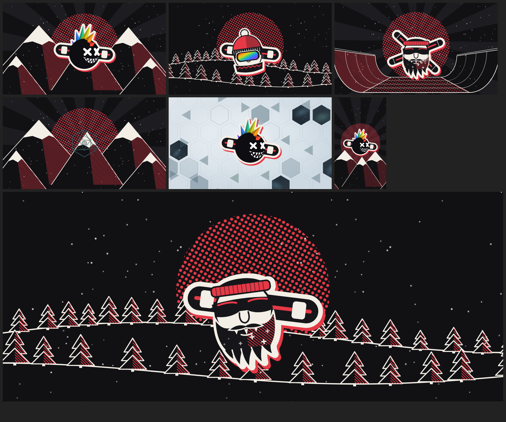

# Graphic mood: zine

Reference for anyone — human or agent — extending the zine mood of the `bgsvg`
crate. It records *why* the output looks the way it does. It is the opposite of
[blueprint](../blueprint/README.md) on purpose: blueprint's rules (no black, no
warmth, two desaturated hues, nothing loud) do **not** apply here, and zine's do
not apply there. A scene that mixes the two keeps each item's own look, even
where the mix looks poor (hexatri's dark steel strokes are faint on the black sheet).

**The mood in one line:** a black one-colour print of snow culture. Paper
linework, one spot ink, a punk sticker in the middle, and the world holding
still around it.

**Touchstones:** gig posters and skate zines, a photocopied sticker slapped on a
black sheet. Not glossy, not gradient, not glowing.

Samples are in [`samples/`](samples/) (configs and the SVGs they render, open them in a
browser to see the animation); [`sheet.png`](sheet.png) is a contact sheet.



## The five rules

**1. Three inks and a rainbow.**
The sheet, the paper and one spot colour. The rainbow belongs to the character
only (the crest, the lenses) and never to the ground. A mountain, a pine or a
pipe is never a rainbow colour.

**2. Print, don't paint.**
Shading is hatching (45° lines, spacing 6, width 1.4) or halftone (dots of
radius 2.6 on an 8-unit grid, rotated 30°), never a gradient. The rainbow lens
is the one gradient.

**3. Everything at the centre is a sticker.**
A die-cut paper outline about 6 units wide and a hard spot-colour shadow offset
(4, 5). The board and skis carry their own outline and shadow and spin with
them.

**4. The halftone disc is the halo.**
It sets the head apart by printing behind it, never by glowing. Same job as
blueprint's halo, opposite method: that one erases, this one prints.

**5. Head motion has a beat; the world is ambient.**
Every head animation runs on one tempo (`bpm`, default 96). The sunburst (120 s)
and the snow (18 s) stay slow and never sync to it.

## Palette

`src/zine/style.rs` is the source of truth.

| role | value | notes |
|------|-------|-------|
| sheet | `#111114` | the page; never pure black |
| paper | `#f3efe6` | lines, snowcaps, snow, the sticker edge |
| ink | `#16161a` | on paper (the sticker's lines, a beanie's hatching) |
| head | `#0d0d12` | head fill |
| rays | `#1c1c21` | the sunburst's dim wedges |
| spot | `#e63946` | default `zine.spot`; `#rrggbb` only, no alpha, because it is a print ink |
| rainbow | `#ff3b3b #ff8a1f #ffd400 #2ed573 #1e90ff #5b4bff #c04bff` | front to back; shade = darkened 28% |

The **spot** drives everything that carries it: the halftone disc, the sticker
shadow, the gear stripe, every hatched shadow face (scenery and beard), and the
park rider's beanie unless `park.beanie` is set. The beanie's own hatching
stays ink, because spot hatching on a spot beanie would vanish. `zine.spot` is
per mood, not per item, so a background and a head can never disagree; a zine
icon on the blueprint lattice still reads it.

## Geometry and layout

- Scale is `s = min(w, h) / 360`; the mockups were a 640×360 canvas.
- **Head-anchored:** the head, the halftone disc and the sunburst sit at the frame
  centre `(w/2, h/2 + 14s)`. A mockup point `(x, y)` anchored to the head maps to
  `(w/2 + (x−320)s, h/2 + 14s + (y−194)s)`.
- **Frame-anchored:** horizontal scenery spans the frame width (summit peaks sit at
  fractions of the width, pine rows and the halfpipe run edge to edge), heights
  scale with `min(w, h)`, and the ground, hill feet and pipe floor sit on the bottom
  edge. On a wide frame the summit adds peaks rather than stretching five; on a
  narrow one it keeps the two flanking peaks inside the frame.
- The corpus only renders 1080p, so [`summit-punk-mobile`](samples/summit-punk-mobile.svg)
  and [`treeline-local-ultrawide`](samples/treeline-local-ultrawide.svg) exist to be looked at.

## Backgrounds

All three: black sheet, paper linework, spot hatching, a spot halftone disc behind the
head, and snow. Geometry depends only on `seed` and draws from its own RNG stream
(`"summit:{seed}"`, `"treeline:{seed}"`, `"snow:{seed}"`), never `"trihex:{seed}"`,
so the icon, the settings and the overlay never move a mountain.

- **`summit`** — a sunburst of 14 dim wedges (of 28) turning once every 120 s from just
  above the head, behind five peaks: two big flanking the head, one behind it, two small in
  front, with seeded jitter around that composition (never a uniform random range). Each
  peak is black with a paper outline on both slopes and no baseline; its shadow face runs
  apex → right foot → a point 18% along the base and is hatched; a jagged snowcap covers
  the top 27%; a black ground band hides the feet. *Why the constraints:* five peaks in a
  fixed composition keep the head clear and the picture balanced; jitter keeps seeds
  distinct without ever producing a collision.
- **`treeline`** — no sunburst. Two rolling hill lines in paper, with pines along them at
  seeded spacing (three stacked tiers, black fill, paper outline 1.8, hatched right half).
  The back row leaves the head zone clear: a pine behind the sticker would read as part of
  it.
- **`halfpipe`** — the pipe from one end. A near and a far U-section with quarter-ellipse
  transitions; the far one is wider than the head so walls and floor read as one pipe
  underneath it. Left wall hatched, right wall black, floor spot halftone at 60%, three
  ribs, lip, coping and deck lines, and the summit's sunburst centred higher. The seed varies
  only the snow.
- **Snow** (`snow` on each background) — `FLURRY` (default): paper squares 1.6–2.9 units,
  opacity 0.4–0.9, an 18 s loop. `BLIZZARD`: slanted streaks, about three times as dense, a
  6 s loop drifting left. `NO_SNOW`: none. Density is per unit of area, so file size scales
  with resolution, not with a fixed count.

## The sticker

Draw it as geometry, never a filter. A thick paper stroke sits under each shape and a
translated spot copy beneath that. (The mockups used an `feMorphology` filter; wrapped
round a spinning board it is re-rasterised every frame, so it is forbidden. See the
rules for extending, below.) The gear is never wrapped by the head's motion, so the head
bobs and the board turns behind it as one sticker.

## Icons

All three share the gear, the spin and the beat (`rider`):

- **Board:** a rounded rect 216×42, black, paper outline 3, a spot stripe 192×6, paper
  bindings 22×28. **`CROSSED_SKIS`:** two 216×26 twin-tips crossed at ±32°, each with a spot
  stripe, tip lines and a central binding. Skis never sit side by side (explored and dropped).
- **Spin:** one turn takes `60 / spin_rpm` s (default 8 rpm); `0` means no animation;
  `counter_clockwise` reverses it.
- **Head motion:** `BOB` lifts 7 units every beat; `SWAY` rocks ±8° over 2 beats about the
  neck. It moves the head group only, never the gear. `bpm` is 40–200 (0 = 96) and the
  beat is `60000 / bpm` ms, kept in milliseconds so 96 bpm is exactly 625 ms.

- **`punk`** — a three-quarter head turned 35°, features drawn on the front-view disc and
  wrapped onto a sphere (`Z = √(r² − x² − (y−8)²)`): white cross eyes, a banana grin of
  interleaved teeth, and a seven-spike rainbow mohawk in the head's mid-plane (spikes behind
  the head are drawn behind). Toggles: `crest_wave` (each spike rocks ±7° on the beat, phased
  0.13 beat apart), `rainbow_flow` (the crest colours travel once every 8 beats), `chatter`
  (the lower teeth drop 4 units every half beat), `eyes: POP` (the eyes scale to 1.45 every
  4 beats). The silhouette takes only the wave, so the paper edge follows the crest without
  tinting.
- **`park`** — a front face under a hatched beanie (`beanie`, or the spot) with a ribbed cuff,
  a paper pompom, rainbow mirror goggles and a black gaiter with a spot zig-zag. Toggles:
  `pompom` (wobbles ±16°), `lens_flow` (colours travel, every 8 beats), `glint` (a paper bar
  crosses the lens every 4 beats, clipped to it), `breath` (three puffs from the gaiter every
  2 beats).
- **`local`** — a front face under a rolled black cap with a spot band, black wraparounds
  with spot reflections, and a big black beard ending in five locks, hatched on the right half
  and clipped to the beard (never to a box). Toggles: `beard_wind` (the mass stays still, the
  locks swing ±9°, phased 0.18 beat), `frost` (crosses twinkle, staggered), `glint` (on the
  wraparounds), `breath` (puffs from under the moustache).

## Motion, reduced motion and the beat

Every animated element's un-animated state is its resting state, and the closing
`@media (prefers-reduced-motion)` rule removes every animation, so the print never
depends on motion:

- the board rests horizontal and the head upright and centred;
- the sunburst and the snow rest where they start;
- elements that exist only in motion (glint, breath) rest **invisible**;
- each crest spike carries its own colour as a plain attribute, and its flow keyframes are
  offset so the picture at `t = 0` is that same colour.

This was checked by rendering a punk with every toggle on under reduced motion: it is
byte-identical (as a PNG) to the plain punk's.

## Cost

A summit at 1080p is the most expensive thing the crate draws. These are rAF-callback counts
over 10 s of real time (after a 1 s warm-up) in headless chromium, **software rasterisation**,
three runs of each variant back to back; the table is the median. The harness counts
`requestAnimationFrame` callbacks and a gap over 25 ms as a dropped frame.

| variant (1080p, summit + punk, rider spinning, head still) | median frames in 10 s | fps | vs (a) |
|---|---|---|---|
| (a) as rendered | 149 | 14.9 | 100% |
| (b) sunburst rotation removed (`.zrays` animation off) | 257 | 25.7 | 172% |
| (c) snow removed (`NO_SNOW`) | 196 | 19.6 | 132% |
| (d) both removed | 597 | 59.7 | 401% |
| reference: blueprint `CLOSEOPEN` + `STARFIELD`, hexatri | 278 | 27.8 | 187% |

Runs: (a) 147 / 149 / 150, (b) 257 / 259 / 254, (c) 188 / 196 / 198, (d) 597 / 601 / 596,
reference 265 / 278 / 280. Dropped frames: about 140 in (a), 240 in (b), 190 in (c), 0–4 in (d).

Caveats, as in blueprint's measurements: this is software rasterisation with no GPU, a GPU
likely sits at 60 fps for every variant and the differences shrink toward nothing, and
absolute rates move a lot with machine load (8 cores, load average about 4–5 here), so only
same-batch comparisons mean anything. The variants are edits of the rendered SVG, not of the crate.

**The sunburst dominates, with the snow second.** Stopping the rotation alone gains 72%, removing
the snow alone 32%, and removing both takes the scene from 15 fps to a flat 60. The two are
super-additive because each forces a repaint of the full frame: a rotating wedge layer is
re-rasterised across the whole canvas every frame, and the snow flurry is another full-frame
animated layer over the halftone. The head, the board and the hatched scenery cost nothing
measurable once both are gone. The summit is slower than the blueprint's worst case (a 76-window
`CLOSEOPEN` starfield, 27.8 fps in the same batch). Nothing was changed in the crate: this
records where the cost is. If it ever has to come down, the sunburst is the lever (its 120 s
period means a slower or paused rotation costs nothing visible), then the snow.
Treeline has no sunburst, and halfpipe's sits behind the pipe, so neither was measured.

### The rainbow flow, measured before shipping

The reference mockups animate the crest and the lenses with `filter: hue-rotate()`, a filter
over animated content. The spec said to measure it and replace it if it cost frames. A 1080p
summit + punk, three runs each, back to back:

| | A: `hue-rotate` (mockup) | B: per-spike fill keyframes (shipped) | C: no flow |
|---|---|---|---|
| full scene, median frames in 10 s | 124 (12.4 fps) | 120 (12.0 fps) | 126 (12.6 fps) |
| rays and snow frozen, median frames | 472 (47.2 fps) | 555 (55.5 fps) | 566 (56.6 fps) |
| dropped frames, rays and snow frozen | 117–127 | 43–51 | 9–45 |

On the full scene the three are indistinguishable (A is 103% of B): the rotating sunburst and
the snow already saturate the software rasteriser at about 12 fps, so the control has no
sensitivity. With the world's animation frozen, the filter is **85% of B's frame rate** with
about 2.5× the dropped frames, while B costs about 2% against no flow at all. So the filter
does cost frames, **B ships**, and no zine output contains a `filter`. B also never leaves
the palette; hue-rotation passes through olive and pink. `lens_flow` follows the same rule.

## Extending

**Do:** draw shading as hatching or halftone; keep geometry in `src/zine/` and compute
every value in Rust; give a new animation a `z`-prefixed class, a rule that ships only when
its feature is on, and a resting state under reduced motion; put new detail at the head or
the bottom edge.

**Don't:** use an SVG `filter` or `hue-rotate` anywhere (the sticker outline is geometry; the
flows are colour keyframes); use a gradient except the lens; let the rainbow reach a ground;
draw from `"trihex:{seed}"`; add a zine def or CSS rule that appears when no zine item is in
the scene; put a second beat on the head.

## Regenerating

```sh
nix develop -c cargo build --release
for f in docs/moods/zine/samples/*.json; do target/release/bgsvg "$f"; done
```

The `.svg` files in `samples/` are the live artifacts; `sheet.png` is a still of them.
